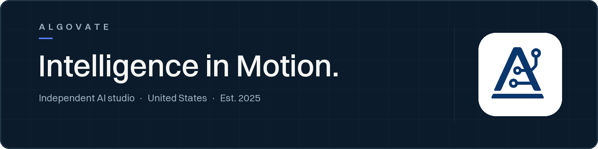

  <picture>
    <source media="(max-width: 600px)" srcset="assets/banner-mobile-2026.png">
    
  </picture>

  Algovate turns emerging AI capability into open tools, working systems, and durable ventures.
   
  We build in public, following adoption from first prototype to operating product.

---

## What we do

### AI Infrastructure

MCP systems, agent orchestration, model gateways, and automation built for real operating environments.

### Intelligent Products

Focused tools that turn emerging capabilities into clear, practical utility.

### Venture Incubation

Rapid experiments developed into durable products and businesses when genuine momentum appears.

## Selected work

### [xhs-mcp](https://github.com/Algovate/xhs-mcp)

Agent infrastructure · TypeScript

MCP server and CLI for social platform publishing, search, recommendations, and workflow automation.

### [Zephyr](https://github.com/Algovate/Zephyr)

AI gateway · Python

A multimodal AI generation gateway designed to unify creative model workflows.

### [Quanta](https://github.com/Algovate/Quanta)

Market intelligence · TypeScript

An AI-powered quantitative system for real-time market analysis and decision support.

[Browse all public work →](https://github.com/Algovate)

## How we work

> Open source is how we learn in public.

1. **Build quickly.** Turn a new technical signal into something concrete.
2. **Publish openly.** Release useful primitives and invite real scrutiny.
3. **Follow adoption.** Let usage reveal where durable value is forming.
4. **Invest deeply.** Commit to the strongest ideas with long-term intent.

## Work with us

For strategic partnerships, ambitious product ideas, and conversations about what comes next.

  <a href="https://github.com/Algovate/algovate.github.io/issues/new?template=partnership.yml"><strong>Start a conversation →</strong></a>
  &nbsp;&nbsp;·&nbsp;&nbsp;
  <a href="https://algovate.github.io/"><strong>Website →</strong></a>

  Conversations open as a public GitHub issue. Please do not share confidential information.

---

  Algovate · Intelligence in Motion · United States

